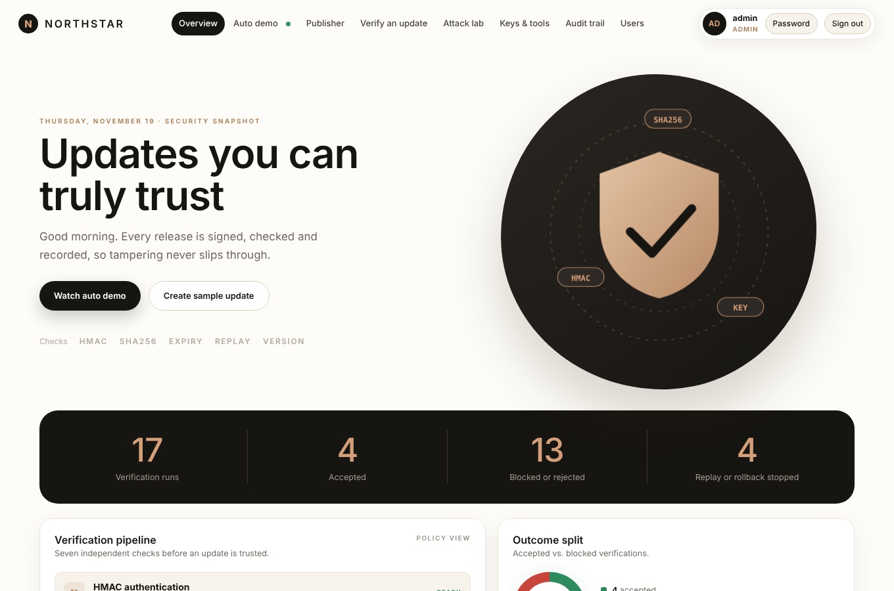
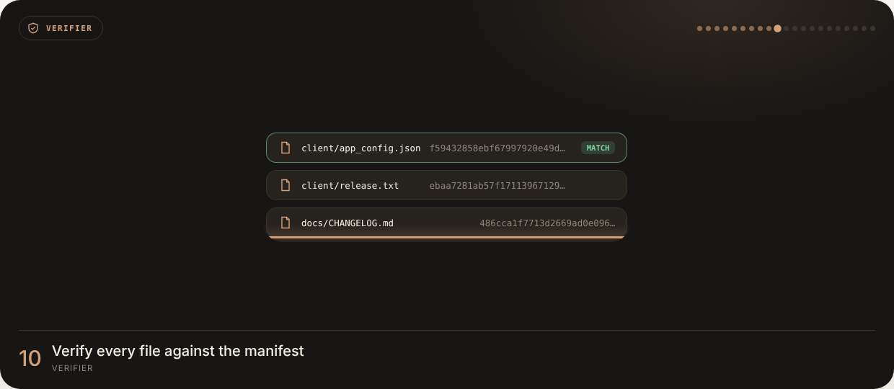
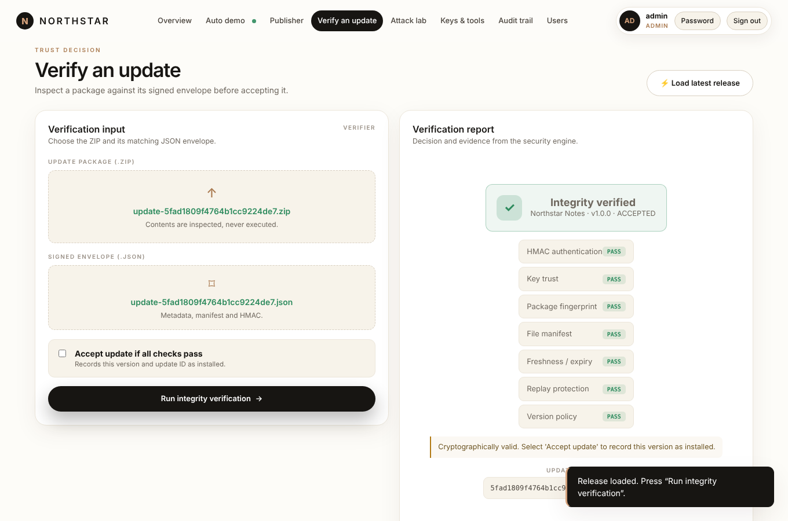
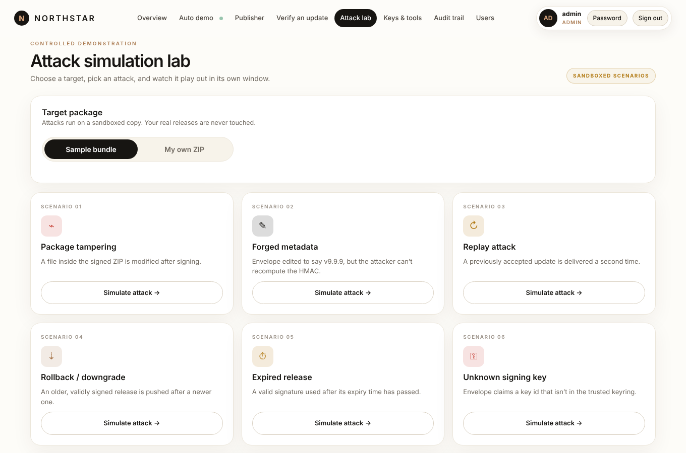
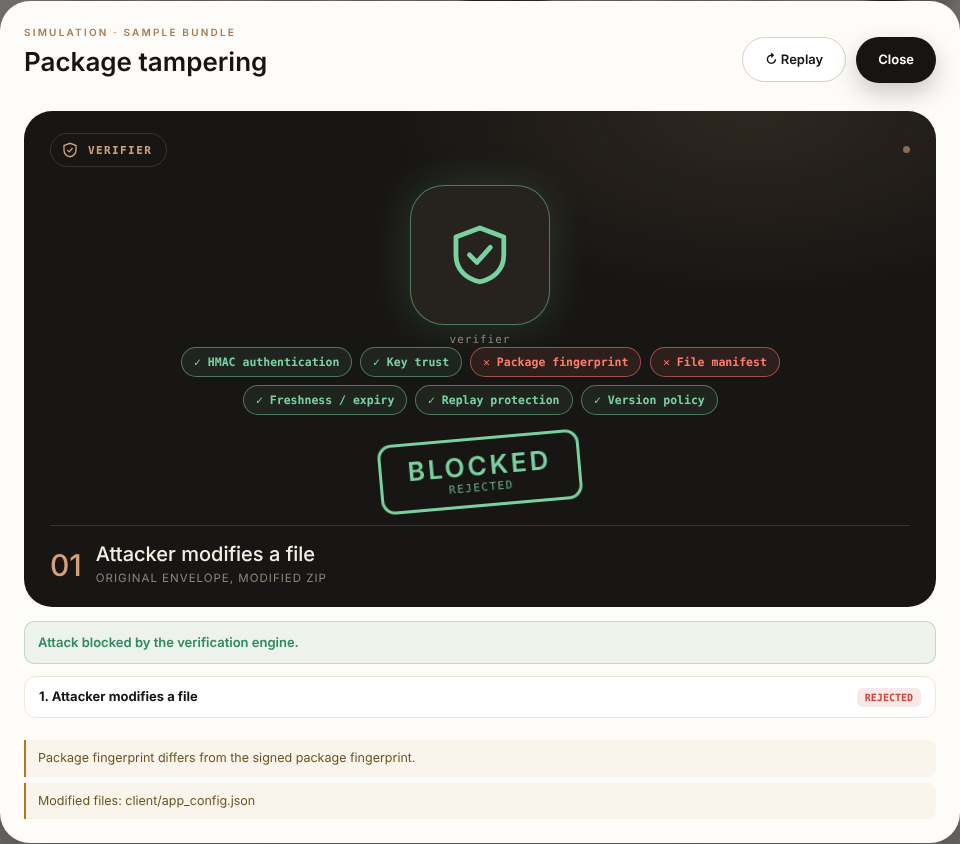

# HMAC SHA256 Update Integrity Verification Platform

A web based platform that signs and verifies software update packages using HMAC SHA256 authentication and SHA256 file fingerprints. It protects against tampering, forged metadata, replay, rollback and expired releases, and includes an attack simulation lab, an animated walkthrough and a hash chained audit trail.

This is an educational prototype built to demonstrate how layered integrity checks work together. It is not a production update system.



## Features

* **Signed releases:** every ZIP update is described by a canonical JSON envelope that is signed with HMAC SHA256 using a keyring with an active key.
* **Seven independent checks:** HMAC authentication, key trust, package fingerprint, file manifest, freshness and expiry, replay protection and version policy.
* **Attack simulation lab:** run tampering, forged metadata, replay, rollback, expired release and unknown key attacks on the sample bundle or on your own ZIP. Each attack plays in its own window with the real result from the engine.
* **Animated auto demo:** a 21 step visual walkthrough of the whole lifecycle, from building a package to blocking six attacks, with pause and speed controls.
* **Key rotation:** create a new active key while older keys stay trusted for verifying earlier releases.
* **Hash chained audit log:** every event is linked to the previous one, with chain verification, filters and CSV export.
* **Role based access:** admin, publisher and verifier roles with PBKDF2 password hashing, server side sessions and account lockout.
* **Hash and HMAC playground:** compute and compare tags with a constant time check.

## Screenshots






## How it works

1. **Publish:** the publisher uploads or generates a ZIP. The platform records a SHA256 hash of every file and of the whole package, adds metadata (application, version, update ID, key ID, expiry) and signs the canonical JSON with HMAC SHA256.
2. **Verify:** the verifier receives the package and the signed envelope. The package is inspected safely without extracting or running it, then seven checks run in order.
3. **Decide:** the update is accepted only if every check passes. Accepted versions and update IDs are recorded, so a replayed or older update is refused later.
4. **Record:** every action is written to the hash chained audit log.

## Tech stack

* Python 3.10 or newer and FastAPI
* SQLite for audit history, sessions and accepted updates
* HTML, CSS and plain JavaScript for the interface, with no build step

## Getting started

1. Clone the repository and open the folder in a terminal.
2. Create and activate a virtual environment:

   ```
   py -m venv .venv
   .\.venv\Scripts\Activate.ps1
   ```

   On macOS or Linux use `python3 -m venv .venv` and `source .venv/bin/activate`.

3. Install the dependencies:

   ```
   python -m pip install -r requirements.txt
   ```

4. Copy `.env.example` to `.env` and set `APP_SECRET` to a long random value.
5. Start the application:

   ```
   python run.py
   ```

6. Open `http://127.0.0.1:8000`. On first run an `admin` account is created and its password is printed once in the terminal. If you forget it, run `python reset_admin.py`.

## Suggested first tour

1. Open **Auto demo** and press start to watch the full lifecycle.
2. Go to **Publisher** and create a sample update.
3. Open **Verify an update**, load the latest release and run the verification. It should pass.
4. Open **Attack lab**, choose the sample bundle or upload your own ZIP, and run each attack.
5. Open **Keys and tools**, rotate the key, then verify the earlier release again.
6. Open **Audit trail** and run the chain verification.

## Roles

* **admin:** everything, including user management and key rotation
* **publisher:** publish updates, view keys, use the hash and HMAC tool
* **verifier:** verify updates and use the attack lab
* **all roles:** overview and audit trail

## Project structure

```text
app/
  main.py          FastAPI routes and the verification workflow
  security.py      HMAC, manifest, ZIP safety and attack checks
  auth.py          Password hashing, sessions and lockout
  database.py      SQLite audit log and accepted update records
  demo.py          Engine trace used by the auto demo
  static/
    index.html     Interface
    styles.css     Base styles
    theme.css      Theme, layout and animation styles
    app.js         Pages, forms and the attack lab
    demo-stage.js  Animated demo and simulation window
data/              Generated at run time (keys, database, packages), not committed
run.py
reset_admin.py
requirements.txt
```

## Security notes

* Uploaded ZIP files are inspected but never extracted to disk or executed.
* Entries with absolute paths, `..` traversal, encryption or symbolic links are rejected, and size and file count limits apply.
* The manifest is authenticated together with the update metadata.
* A valid HMAC alone does not prove freshness, so version, expiry and replay state are checked separately.
* Passwords use PBKDF2 HMAC SHA256 with 600,000 iterations and a per user salt. Sessions are stored server side as hashes, use an HttpOnly and SameSite Strict cookie, and expire after 8 hours. Five failed sign ins lock an account for 5 minutes.
* Attack simulations on uploaded files always run in a sandboxed application, so real release state is never changed.

## Limitations and future work

* **Shared secret:** HMAC uses one secret key that both the signer and the verifier must hold. Real public software updates use asymmetric signatures such as Ed25519 so that verifiers cannot create signatures. A future version could add this.
* **Key storage:** keys are kept in a local file for convenience. A production system needs a secret manager or hardware backed storage.
* **Prototype scope:** there is no real update agent, transport security or hardware root of trust, and the platform never installs the software it verifies.
* **Possible extensions:** signature scheme comparison, threshold signing for releases, and integration with a package repository.

## Author

Built by Tharuniya as a Computer Science and Engineering project for Cryptography and Network Security Course at University .
